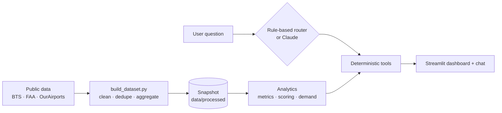
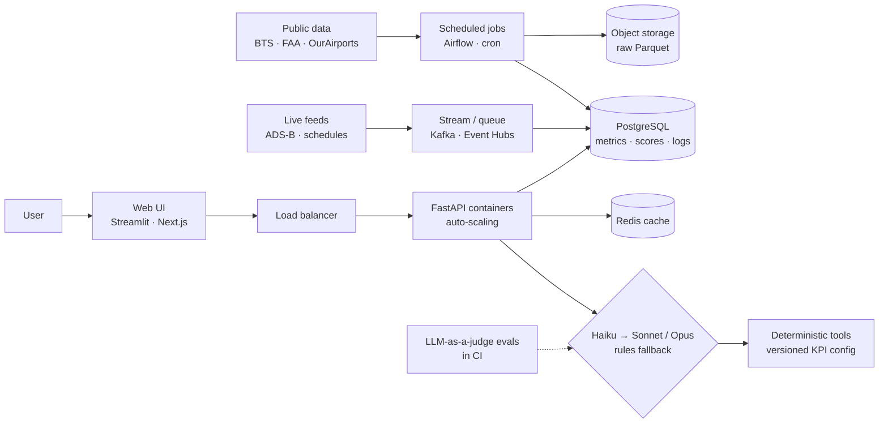

# ✈️ Airport Investment Intelligence Agent

## What it is

A decision-support prototype that helps an investment team **screen U.S. airports for terminal / capacity
investment**. It combines real public aviation data (BTS + FAA), a **deterministic, explainable scoring
model**, and a **chat analyst** that understands informal questions such as *"compare congestion LAX SNA"*.

> **What it is:** a screening tool that tells analysts *where due diligence is worth doing*.
> **What it is not:** an ROI / NPV / profitability forecast or an investment recommendation.

## What it does

An AI-powered analyst agent that can:

- **Answer questions on airport investment candidates** - nationally, by region (*"New England"*) or by state.
- **Compare airport congestion levels and flight demand** over identical periods and definitions.
- **Rank or compare airports using defined logic and KPIs** - a transparent 0-100 score built from passenger
  demand, capacity pressure and flight activity, with adjustable weights.
- **Gather aviation data from public sources** - BTS flight records, FAA passenger counts and OurAirports
  reference data, downloaded, cleaned and cached by a reproducible pipeline.
- **Chat in plain (even sloppy) English and handle follow-ups** - *"how jammed is sfo"*, *"and BOS?"*,
  *"why did BOS rank above BDL"*.
- **Explain its reasoning** - every answer gives the bottom line, evidence, period, sources, caveats, confidence
  and the exact tools it called.
- **Run what-if and sensitivity analysis** on the scoring weights.
- **Say "I don't know" honestly** - it never invents numbers (e.g. no made-up unmet-demand figure), and politely
  declines off-topic questions.

---

## Quick start

```bash
python -m venv .venv
.venv\Scripts\activate
pip install -r requirements.txt
streamlit run app.py
```

> [!NOTE]
> On **macOS / Linux** activate with `source .venv/bin/activate`. Or skip all four steps with the one-command
> launchers `./run.ps1` (Windows) / `./run.sh` (macOS / Linux). Requires Python 3.11 - 3.13 (tested on 3.12).

The app opens at http://localhost:8501. **No API key and no downloads needed** - the processed real-data
snapshot (~1 MB) is committed in `data/processed/`.

<details>
<summary><b>Claude - LLM setup</b> (optional)</summary>

Copy `.env.example` to `.env` and set `ANTHROPIC_API_KEY`. Claude then interprets questions; every number is
still computed by deterministic Python. Verify with:

```bash
python scripts/check_llm.py "how jammed is sfo"
```

- Set `DISABLE_LLM=1` in `.env` to force the rule-based parser.
- A key already set in your OS environment takes precedence over `.env`.
- If the key is missing or the API fails, the app falls back to the rule-based parser automatically.

See [LLM vs Rule-Based](#llm-vs-rule-based).
</details>

<details>
<summary><b>Run tests</b></summary>

```bash
pytest -q
```

114 tests (unit, integration and evaluation cases), no network access needed.
</details>

<details>
<summary><b>Refresh the data from source</b></summary>

```bash
python scripts/build_dataset.py
```

Downloads ~750 MB of BTS files once (cached in `data/raw/`, ~10 - 15 min) plus the FAA and OurAirports files,
then rebuilds `data/processed/` with a provenance manifest.
</details>

---

## 5-minute demo

| # | Where | What to do / ask | What it shows |
|---|---|---|---|
| 1 | 🏠 Overview | Point at the map, top-10 chart and the three "how to read" cards | Score vs. confidence vs. "not ROI" |
| 2 | 🎚️ Sidebar | Move the weight sliders (e.g. capacity pressure up) | Live re-ranking across every tab |
| 3 | 🤖 AI Analyst | *Which airports in New England are strong candidates for terminal expansion?* → *why did BOS rank above BDL* | Regional ranking with reasons, follow-up explanation |
| 4 | 🤖 AI Analyst | *compare congestion LAX SNA* → *what about SAN* → *unmet demand at SFO - what's going on?* | Slang, same-period comparison, context, **refuses to invent** an unmet-demand number |
| 5 | 🤖 AI Analyst | *what if capacity weight is 50%* → *tell me a joke* | What-if scenarios; graceful off-topic handling |
| 6 | 📊 Opportunities | Filter Region = New England, then Confidence = High | Ranked table with score bands and confidence |
| 7 | 📊 Opportunities | Read the *Why* column for a top airport | Plain-language reasons from percentile inputs |
| 8 | 📊 Opportunities | Expand "Sensitivity analysis" | Rank ranges under +/-10pp weight changes - top 10 is robust |
| 9 | ⚖️ Compare | Pick LAX + SNA (+ SAN) | Side-by-side table, identical period, explicit `MISSING` markers |
| 10 | ⚖️ Compare | Scroll to the component and congestion-percentile charts | Where each airport sits vs. 141 peers |
| 11 | ⚖️ Compare | Monthly trends + "Analyst summary of material differences" | Seasonality and the differences that matter |
| 12 | 🔎 Airport detail | Select SFO | Score, rank, confidence and the "why" |
| 13 | 🔎 Airport detail | Scroll to congestion and demand evidence | Proxies, cited hypotheses, honest unmet-demand statement |
| 14 | 🔎 Airport detail | Select ANC, move the long-haul threshold slider | Long-haul share with numerator / denominator and exclusions |

Open "🔧 How this was answered" under any chat answer to show the parsed intent, the parser used (rules / LLM)
and the exact tools called.

---

## How it works



`scripts/build_dataset.py` downloads **14.1 M real flight records** (BTS On-Time Performance, Jan 2024 - Dec
2025), **FAA calendar-year passenger boardings** (CY2019/24/25) and **OurAirports** coordinates, then cleans and
aggregates them into a small snapshot with a provenance manifest. The analytics layer computes metrics, a
congestion-proxy index and a 0-100 **opportunity score** (percentiles vs. 141 U.S. hub airports; weights:
demand 40 %, capacity pressure 35 %, flight activity 25 %). The chat agent maps each question to one of ~12
deterministic tools; Claude (optional) only helps choose the tool.

Details: [docs/architecture.md](docs/architecture.md) · [docs/data_sources.md](docs/data_sources.md)

## Why OurAirports, BTS and FAA

| Source | Why it was chosen | Alternatives considered |
|---|---|---|
| **BTS On-Time Performance** | Free direct monthly downloads (no login), **one row per flight** with scheduled times, delays, taxi times, cancellations and distance - exactly what congestion, peak-hour and long-haul metrics need. Official U.S. DOT data. | **BTS T-100** (seats, load factors, international) needs form-driven downloads - the first thing to add. **OpenSky** gives live positions, not schedules or passengers, and is rate-limited. **FlightAware / AviationStack / OAG / Cirium** are paid and restrict redistribution. **FAA ASPM** requires an account. |
| **FAA Passenger Boarding (enplanements)** | Official passenger counts for **all carriers incl. international**, plus the FAA hub classification used to define the peer set. Covers 2019 for a pre-pandemic baseline. | Airport annual reports (inconsistent formats); BTS T-100 passenger totals (see above). |
| **OurAirports** | Public domain, complete coordinates for great-circle distances, and the FAA LID -> IATA crosswalk (36 airports differ, e.g. `IWA` -> `AZA`). | FAA NASR airport data (heavier, FAA identifiers only); commercial airport databases (licensed). |

All three are **free, official or public-domain, stable and reproducible** - important for a prototype whose
numbers must be traceable. They are historical, not real-time, which suits annual investment screening.

## LLM vs Rule-Based

The chat works with or without an API key. Only **question understanding** changes; numbers, tools and answer
text are identical in both modes.

| | Rule-based (default, no key) | LLM (`ANTHROPIC_API_KEY` set) |
|---|---|---|
| Understands the question with | `router.py`: regex intents, airport nicknames, city names, typo matching, follow-up context | Claude (`claude-opus-5-5`, low effort, structured output) -> the same validated query object |
| Calculations and answer text | Deterministic Python tools and templates | Same |
| Speed / cost | Instant, free | One API call per question (~1-3 s, a fraction of a cent) |
| Repeatability | Fully deterministic | Usually the same; can vary between runs |
| Strengths | Predictable, testable, no external dependency | Unusual phrasing and world knowledge (*"the airport near Disney"* -> MCO) |
| On failure | - | Falls back to rules automatically (logged) |

- Claude **never sees or produces numbers**, so it cannot hallucinate statistics (verified by a test).
- Regions returned by Claude go through the same normalizer as the rules; unknown regions are flagged, never
  silently applied.
- If the rules don't recognize the airport in an on-topic question, the agent asks which airport you mean.
- The sidebar shows the active mode; "🔧 How this was answered" shows `parser: rules` or `parser: llm`.

## Design decisions

| Decision | Why | Trade-off |
|---|---|---|
| Committed data snapshot, no live API calls at runtime | Fast, reproducible demo; an outage can't silently change numbers | Freshness depends on re-running the pipeline |
| LLM interprets, Python computes | No hallucinated numbers; works without a key | Rules cover fewer phrasings than an LLM |
| Simple router + tools, not multi-agent | ~12 well-defined analyses; easier to test, explain and run cheaply | Less suited to open-ended research questions |
| Percentile normalization | Scale-free, robust to outliers (ATL), easy to explain ("top 10 %") | Hides magnitude differences |
| Confidence reported separately from the score | Airports aren't rewarded just for having more complete data | Two numbers to read instead of one |
| Calendar years for all metrics | BTS flights align exactly with FAA annual passenger data | Most recent months (2026) not used |
| No numeric unmet-demand estimate | Realized traffic can't measure rejected demand; we say so and list the data needed | Less "impressive" answer, but defensible |
| Streamlit UI | One Python codebase, quick to build and demo | Not a production front end (see below) |

## Project layout

```
app.py                       Streamlit UI (6 tabs + chat)
src/config.py                periods, thresholds, weights (all assumptions in one place)
src/data_sources/            BTS / FAA / OurAirports ingestion, cached HTTP, snapshot loader
src/analytics/               metrics.py, scoring.py (incl. congestion index + sensitivity), demand.py
src/agent/                   router.py (rules), llm.py (optional Claude), tools.py, orchestrator.py
src/sources.py               source + metric registry (observed vs derived, period, limitations)
data/processed/              committed real-data snapshot + manifest.json
data/context/                curated, cited qualitative notes (hypotheses only, never scored)
scripts/                     build_dataset.py, download_bts.py, check_llm.py
tests/                       114 unit / integration / evaluation tests
```

## Example questions

| Question | Answer |
|---|---|
| Which airports in New England are strong candidates for terminal expansion? | ✅ Ranked with reasons; BOS is the only "strong" candidate (#9 nationally); non-hub airports listed as not scored |
| Compare congestion levels at LAX and SNA | ✅ Capacity-pressure index + five raw proxies over the identical period, plus context (SNA's settlement agreement) |
| What percentage of flights departing Anchorage are long-haul? | ✅ 18.5 % (3,446 / 18,650 eligible departures, CY2025, >= 2,485 mi) with coverage caveats |
| What is the unmet flight demand at SFO, and what might explain it? | ⚠️ By design no number - proxy evidence (Elevated pressure), hypotheses and the datasets needed to quantify it |
| Which airports are most promising according to the scoring model? | ✅ ORD, DEN, MCO, BNA, MIA … with component breakdown; robust to +/-10pp weight changes |
| What additional data would be needed to validate an investment? | ✅ Grouped: unmet demand, underwriting, and prototype improvements |

Follow-ups supported: *why did BOS rank above BDL*, *what if I increase capacity weight*, *which data sources
support this*, *compare both airports over the same period*, *show the evidence behind the congestion score*,
*which assumptions matter most*, *what about SAN*.

## Key limitations

- Flight data = **domestic flights of BTS reporting carriers** only; international gateways (JFK, MIA, LAX…)
  are flagged *Medium* confidence because a large share of their passengers is not in the flight data.
- **Congestion is proxied** (delays, taxi-out, NAS delay, peak-hour schedule) - not terminal utilization.
- **Unmet demand is never estimated numerically**; feasibility (land, regulation, existing capex) and
  financial returns are out of scope.
- Weights are **prototype assumptions**; the sensitivity analysis shows how much they matter.

---

## What I would change for Production



**Data storage**
- **Object storage (S3 / Azure Blob / GCS)** for raw downloads as partitioned Parquet - cheap, immutable, replayable.
- **PostgreSQL** (managed: AWS RDS, Azure Database for PostgreSQL, Neon / Supabase) as the serving database for
  airport metrics, scores, model versions, users and chat logs; add the **TimescaleDB** extension (or native
  partitioning) for monthly time series.
- A columnar warehouse (**BigQuery / Snowflake / DuckDB-MotherDuck**) only once raw flight-level analysis is
  needed interactively; at today's aggregated scale Postgres is enough.

**Ingestion, spikes and streams**
- Today's sources are monthly / annual batches. Live feeds (ADS-B, FAA SWIM, airline schedule updates) would go
  through a **queue / stream (Kafka, Redpanda, Kinesis, Azure Event Hubs)** so bursts are absorbed instead of
  overloading the database.
- Consumers write **idempotent upserts** of aggregates, with a dead-letter queue for bad messages and
  backpressure / rate limiting toward external APIs.

**Scheduled jobs**
- **Cron-style orchestration** (Airflow, Prefect or Dagster; simpler: GitHub Actions schedules or Railway cron):
  a monthly BTS job, an annual FAA job, then re-scoring.
- Each run: retries, schema checks (the parsers already raise on drift), data-quality tests (row counts, nulls,
  ranges), a versioned snapshot, and alerts on failure. A failed run never replaces the last good snapshot.

**API servers and front end**
- Split the app into a **FastAPI backend** (`/score`, `/compare`, `/ask`) and a front end (keep Streamlit for
  internal use, or a Next.js UI for clients).
- Stateless API containers behind a **load balancer**, **Redis** caching scored tables per weight
  configuration, SSO authentication, per-user rate limits and an audit trail.

**AI Analyst under load**
- **Model choice:** route intent parsing to a small, fast model (Claude Haiku 5.5) and escalate only ambiguous
  questions to Claude Sonnet 5.5 / Opus 5.5. Use prompt caching for the static system prompt, stream responses,
  and set per-user token budgets. The rule-based router stays as the zero-cost fallback.
- **Multi-agent:** not needed for the current ~12 tools. Worth it when adding document research (airport master
  plans, financial statements, news): a planner agent plus research sub-agents with retrieval (e.g. pgvector) -
  while deterministic tools remain the **only** source of numbers.
- **LLM-as-a-judge:** an offline evaluation set (labeled questions incl. slang, adversarial and off-topic) graded
  automatically for routing accuracy and faithfulness (every number in an answer must match a tool output). Run
  it in CI on every prompt or model change, sample live traffic weekly, and keep a human review loop.

**Generic scoring methodology**
- Move KPI definitions out of code into **versioned configuration** (YAML or a database table): for each KPI, its
  source field, transform (percentile, z-score, log, min-max), direction, component and weight.
- Saved **weight profiles** per team or client, a model version stored with every score, and **back-testing**
  against realized outcomes (later traffic growth, approved capital programs) before weights are trusted.

**Deployment, containers and auto-scaling**
- **Docker** images for the API, the UI and the pipeline workers; infrastructure as code (Terraform).
- **Quick hosting:** Railway, Render or Fly.io run the containers plus managed Postgres and cron with little
  setup. **Vercel** fits a Next.js front end but not long-running Python / Streamlit WebSockets, so it would pair
  with an API hosted elsewhere.
- **Enterprise:** AWS ECS Fargate / Google Cloud Run / Azure Container Apps behind a load balancer, **auto-scaling**
  on CPU and requests per second, with sticky sessions for Streamlit's WebSocket connections. Claude is also
  available through Amazon Bedrock and Microsoft Foundry for data-residency or procurement requirements.
- **Operations:** secrets in a secrets manager, structured logs and tracing (OpenTelemetry), dashboards for
  latency, LLM cost and fallback rate, and CI running the test suite before every deploy.

**Before real investment decisions:** add validated capacity and demand data (T-100 load factors, FAA ASPM,
gate / terminal capacity), feasibility and financial models (FAA CATS, capex), back-tested and approved weights,
and an independent methodology review.
