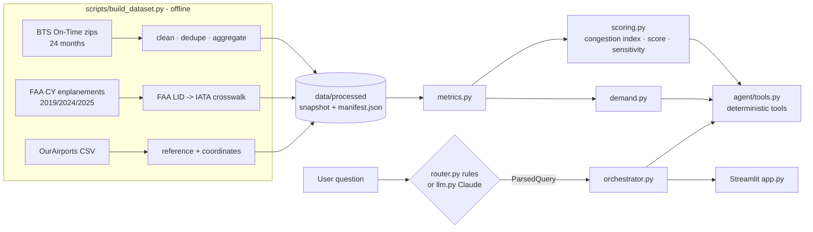

# Architecture - Airport Investment Intelligence Agent

## 1. Business problem and users

A (hypothetical) investment firm funds U.S. airport modernization. Its analysts need to decide **which airports
deserve due diligence for terminal / capacity investment**. Today that means stitching together BTS and FAA
statistics by hand. The prototype gives them a ranked, explainable shortlist, side-by-side comparisons and a chat
analyst that answers informal questions with sourced evidence.

Users: investment analysts (daily), team leads / partners (review rankings and the reasoning behind them).
It is a **screening** tool. It does not replace demand forecasting, engineering, underwriting or regulatory review.

## 2. System architecture and data flow

* **Acquisition** runs offline and writes a ~1 MB snapshot (parquet/CSV) that is committed. The app never calls
  external APIs at runtime, so the demo is fast and reproducible and an outage cannot silently change numbers.
* **Analytics** are pure pandas functions over that snapshot - unit-testable, no I/O.
* **Agent**: a question becomes a validated `ParsedQuery` (intent, airports, region, weights…). The orchestrator
  runs the matching deterministic tool(s) and renders the answer.
* **UI**: six tabs (Overview, AI Analyst, Opportunities, Compare, Airport detail, Methodology & sources). The
  sidebar weights re-score everything live.

## 3. Data sources and limitations

| Source | Used for | Main limitation |
|---|---|---|
| BTS Reporting Carrier On-Time Performance (Jan 2024 - Dec 2025, 14.1 M flights) | departures, cancellations, delays, taxi-out, NAS delay, peak hour, routes | domestic flights of reporting carriers only |
| FAA Passenger Boarding Data (CY2019, CY2024, CY2025) | passenger volume, growth, recovery | annual totals only |
| OurAirports | names, states, coordinates (distances) | community-maintained |
| Curated context notes (5 airports, each cited) | hypotheses in explanations | qualitative; never scored |

Full detail in [data_sources.md](data_sources.md). Calendar years are used everywhere so that BTS flight data
and FAA passenger data cover **exactly the same period**.

## 4. Scoring methodology and weight selection

1. **Peer set:** FAA large / medium / small hubs with >= 1,000 reporting-carrier departures (141 airports).
2. **Normalization:** each input -> percentile rank among peers (0-100). Percentiles are scale-free, robust to
   outliers (ATL's volume) and easy to explain ("top 10 %").
3. **Components** (sub-weights in `config.py`):
   * *Passenger demand & growth* - enplanements 40 %, YoY growth 35 %, recovery vs 2019 25 %
   * *Capacity pressure (congestion proxy)* - departure delay rate 25 %, taxi-out 25 %, peak-hour movements 20 %,
     NAS delay per arrival 15 %, arrival delay rate 15 %
   * *Flight activity & growth* - operated departures 50 %, YoY growth 50 %
4. **Total:** demand 40 %, capacity pressure 35 %, flight activity 25 % (sidebar-adjustable).
5. **Missing inputs:** dropped and remaining weights re-normalized (neither rewarded nor penalized), and listed.
   If an entire *critical* component (demand or capacity) is missing -> status `insufficient_evidence`, no score.
6. **Evidence confidence (High / Medium / Low)** is computed separately from missing inputs, period coverage,
   sample size and a *coverage ratio* (passengers per BTS-covered departure vs. the peer median - high values
   mean much of the traffic is international / non-reporting and invisible to the flight metrics). Confidence
   **never changes the score** (assignment rule 6: don't reward data completeness).
7. **Sensitivity:** each component weight +/-10 pp (re-normalized) plus equal weights; we report rank ranges,
   top-10 stability and which assumption moves the ranking most. With current data all of the base top-10 stay
   in the top-10 under every scenario.

**Why these weights?** The assignment suggested 35/30/20/15 with 15 % for data confidence. I moved confidence
out of the score (point 6) and redistributed proportionally to 40/35/25. They are **prototype assumptions**,
not validated investment parameters - hence the sliders and the sensitivity analysis. Score bands (65+ strong,
50-65 moderate, < 50 weak) are presentation conventions only.

The score is a relative screening signal, explicitly **not** ROI / NPV / IRR.

## 5. How deterministic code and the LLM interact

| Step | Rule-based mode (default without key) | LLM mode (`ANTHROPIC_API_KEY` set) |
|---|---|---|
| Understand question | `router.py`: regex intents, aliases ("John Wayne" -> SNA), case-aware code matching, typo fuzzing, follow-up context | Claude (`claude-opus-5-5`, low effort, structured output) returns the same `ParsedQuery` schema |
| Validate | Pydantic + airport codes checked against the dataset | same; unknown codes reported, never invented |
| Compute | deterministic tools | identical deterministic tools |
| Write answer | deterministic templates | identical deterministic templates |

The LLM never sees or produces numbers, so it cannot hallucinate a statistic or override a score. Any LLM
failure (network, refusal, invalid output, missing package) falls back to the rule-based router, so the demo
cannot break on the optional path. A test (`test_llm_output_cannot_inject_numbers`) verifies that an LLM-chosen
tool yields the same text as the rule-based path.

## 6. Communicating sources, assumptions and uncertainty

* Every substantive answer ends with **Period · Confidence · Sources · Caveats**.
* Observed vs derived is recorded per metric in `src/sources.py` (also shown in the Methodology tab) with the
  retrieval time from `manifest.json`.
* Proxies are named as proxies ("capacity pressure (congestion proxy)").
* Unmet demand is reported in five explicit layers; the last ("actual unmet demand") states it cannot be
  quantified and lists the datasets needed.
* Qualitative context is labeled as hypotheses with a citation and is never used in the score.
* Missing values are shown as `MISSING`, never as zero.

## 7. Key engineering trade-offs

* **Committed snapshot vs. live API calls** - reproducibility and demo reliability over freshness. BTS is
  monthly/historical anyway; `build_dataset.py` refreshes it.
* **Simple router + one optional LLM call vs. multi-agent framework** - the questions map to ~12 well-defined
  analyses. A single tool-selection step is easier to test, cheaper, deterministic and explainable to a partner.
  Multi-agent orchestration would add latency and failure modes without adding analytical value here.
* **Percentiles vs. min-max / z-scores** - less precise about magnitudes but robust and easy to explain.
* **BTS On-Time vs. T-100** - On-Time is downloadable without forms and gives delays, taxi times and hourly
  schedules (needed for congestion). T-100 (seats, load factors, international) would be the first addition.
* **Calendar years** - lose the most recent months (data exists to Jul 2026) in exchange for exact alignment
  with FAA annual passenger data.

## 8. Known limitations

* Domestic reporting-carrier flights only: no international, most regional, charter or cargo flights.
  ANC's long-haul share is therefore of covered passenger departures, and its cargo role is invisible.
* No direct capacity data (gates, terminal design-hour, runway rates) -> congestion is inferred, not measured.
* No load factors, fares or slot data -> no quantitative unmet demand.
* No feasibility (land, environmental, noise agreements, existing capital programs) or financial data.
* Delay proxies include weather and airline-operations effects.
* The rule-based router covers common phrasings well but not everything; the LLM mode extends coverage.

## 9. Production-readiness improvements

1. Add BTS T-100 (domestic + international segments: seats, load factor) and FAA OPSNET/ASPM; replace delay
   proxies with demand-to-capacity ratios where capacity data exists.
2. Scheduled refresh pipeline (e.g. monthly job) with data-quality checks and versioned snapshots; alert on
   schema drift (already detected and raised by the parsers).
3. Back-test the score against realized outcomes (later growth, approved capital programs) and calibrate weights
   with the investment team; add feasibility and financial modules (FAA CATS financials, capex).
4. Evaluation harness for the chat layer (labeled question set incl. adversarial / off-topic), logging and
   monitoring of parse failures; authentication and per-user audit trail.
5. Package as a service (API + UI), containerize, CI running the test suite.

## 10. Security, privacy, reliability, operations

* **Secrets:** only via environment / `.env` (gitignored); `.env.example` holds placeholders. No key is needed.
* **Privacy:** only public, aggregate aviation data; no personal data. User questions are sent to Anthropic only
  when the user enables the LLM.
* **API reliability:** downloads have timeouts, 3 retries with backoff, atomic `.part` writes and a cache; 404s
  and schema changes raise `DataSourceError` with an actionable message. A failed refresh never overwrites the
  snapshot and never substitutes synthetic data. LLM calls have a 30 s timeout and fall back to rules.
* **Licensing:** U.S. government data (public) and OurAirports (public domain).
* **Logging:** standard `logging` across ingestion and agent; LLM fallbacks are logged as warnings.

## What would need to change before real investment decisions

Validated capacity and demand data (item 1 above), feasibility and financial models, back-tested and
investment-committee-approved weights, independent review of the methodology, and refresh / governance
processes. Until then outputs are hypotheses for due diligence, not conclusions.
